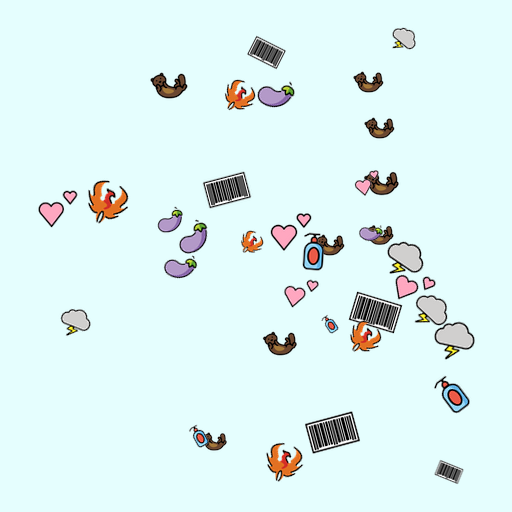
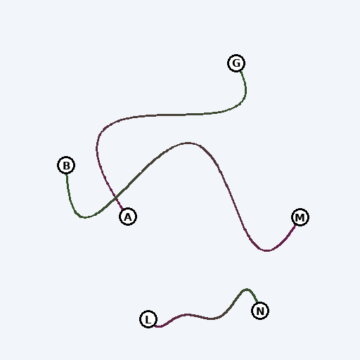
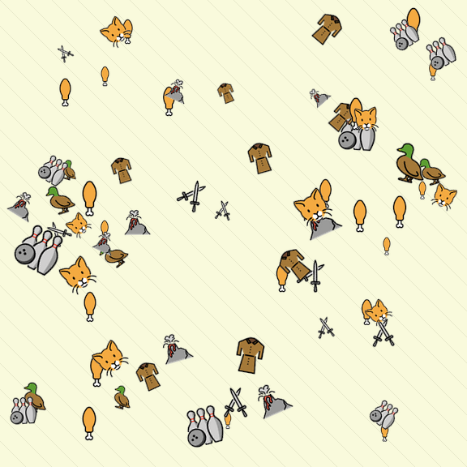
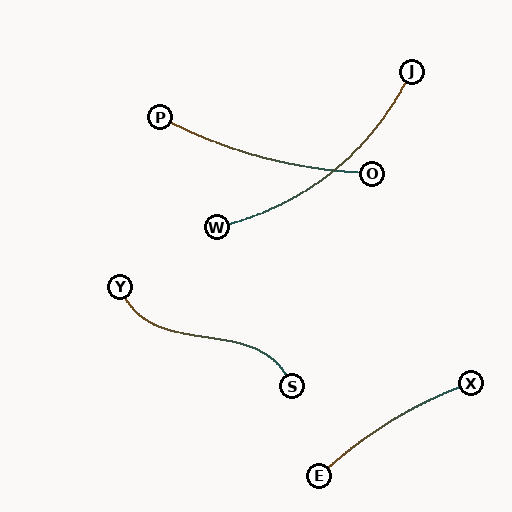
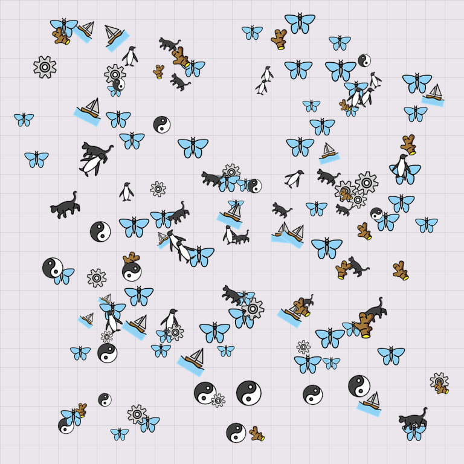
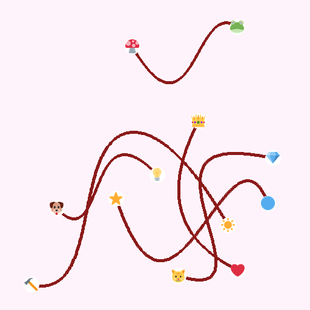

# Visual Scaffolding

**English** · [简体中文](README_zh.md)

Code and benchmark for **Visual Scaffolding: Toward Native Multimodal Reasoning**.

📄 **Paper:** [arXiv:2610.25247](https://arxiv.org/abs/2610.25247) · [PDF](https://arxiv.org/pdf/2610.25247)

| Resource | What it contains | Hugging Face |
|---|---|---|
| 📚 **NMR-Bench** | 780 test images, questions, and answers | [Dataset](https://huggingface.co/datasets/ShaoRun/nmr-bench) |
| 🧮 **Burden Counting model** | Complete task-specific checkpoint | [Model](https://huggingface.co/ShaoRun/vscaffold-4b-burden-counting) |
| 🧵 **Path Tracing model** | Complete task-specific checkpoint | [Model](https://huggingface.co/ShaoRun/vscaffold-4b-path-tracing) |

The dataset and models are distributed on Hugging Face; this repository provides the evaluation and inference code.

## 🔎 The idea

Textual chain-of-thought keeps intermediate statements available for later reasoning, but a short description may lose the identity or spatial detail of something seen in an image. **Native multimodal reasoning** asks whether language and native visual representations can carry reusable intermediate states together.

Visual Scaffolding is one implementation of that idea. While generating a reasoning trace, the model can emit `[ref]` to request visual evidence. A Visual Retriever selects features from a fine-grained representation of the input image; an Evidence Adaptor inserts those features into the trace. Generation then continues with the selected visual content still available to later steps.

`Image + question → reasoning → [ref] → retrieve visual features → insert evidence → continue reasoning`

Our implementation builds on Qwen3-VL-4B-Thinking, with separate checkpoints for the two tasks. This repository includes its inference code and the evaluator for **NMR-Bench**, which probes sustained object identity and spatial continuity. The benchmark data and checkpoints are released as separate Hugging Face repositories.

## 🎯 Benchmark

| Task | What the model does | Test images |
|---|---|---:|
| **Burden Counting** | Count or compare objects in crowded scenes | 420 |
| **Path Tracing** | Match endpoints by following curves through crossings | 360 |

Each test record contains an image, a question, and a canonical answer. The evaluator sends **only the image and question** to the model and keeps the answer for scoring.

### Burden Counting · keeping track of instances

The 420-image test set has **seven question forms**. Five ask for a count under a category or attribute condition: category alone (T1a), size (T2a), tilt (T2b), occlusion (T2c), or size and tilt together (T2d). Two ask the model to compare large and small groups (T3a) or identify the most frequent listed category (T3b).

Each form has **20 Easy, 20 Medium, and 20 Hard** images. Difficulty is set within each form as scenes become more demanding; the levels do not share a single object-count cutoff. Objects can differ in category, size, tilt, and visibility, with distractors mixed into the scene.

### Path Tracing · preserving spatial continuity

The 360-image test set asks for all endpoint pairs formed by non-branching curves. Endpoints use **letters, numbers, icons, or shapes** (90 images of each type). At crossings, the model must follow the continuing curve rather than switch to a nearby line.

| Difficulty | Curves per image | Observed crossings | Test images |
|---|---:|---:|---:|
| **Easy** | 3 | 0–5 | 120 |
| **Medium** | 4–5 | 1–10 | 120 |
| **Hard** | 6–7 | 3–17 | 120 |

Curve count, layout, and crossings vary together in the standard test set.

### 🖼️ Easy → Medium → Hard

| Level | Burden Counting | Path Tracing |
|:---:|:---:|:---:|
| **Easy** |  |  |
| **Medium** |  |  |
| **Hard** |  |  |

All six images are from the test set. The three Counting examples use the same occlusion question form (T2c). Exact queries and ground truths are in the Hugging Face dataset, and its dataset card explains the record format. Image attribution and licenses are in [DATA_LICENSE.md](DATA_LICENSE.md).

## 🚀 Quick start

Python 3.12 is used in the reference environment.

```bash
python -m venv .venv
source .venv/bin/activate
pip install -e .
pip install huggingface_hub
hf download ShaoRun/nmr-bench --repo-type dataset --local-dir benchmark
```

### Score predictions from any model

Create a JSONL file with **one prediction for every test image** in the chosen task. Each line needs a `sample_id` from its `test.jsonl` and the model's raw response:

```json
{"sample_id":"counting_test_T1a_000000","response":"model-generated response"}
```

Then run the scorer:

```bash
python -m visual_scaffolding score \
  --task burden_counting \
  --benchmark benchmark \
  --predictions predictions/counting.jsonl \
  --output outputs/counting-summary.json
```

Use `--task path_tracing` and the corresponding prediction file for Path Tracing. The scorer checks sample coverage and rejects missing or duplicate IDs. The dataset's `SCHEMA.md` describes record fields and answer formats.

### Run a model through the evaluator

The evaluator also accepts a model adapter that implements `predict(image, question)`. See [examples/hf_adapter.py](examples/hf_adapter.py) for a Hugging Face example. Install a PyTorch build compatible with your GPU, then install the inference dependencies:

```bash
pip install -e '.[inference]'
```

Create `model.json` with your model ID, for example `{"model_name":"Qwen/Qwen3-VL-4B-Thinking"}`, and run:

```bash
python -m visual_scaffolding evaluate \
  --task burden_counting \
  --benchmark benchmark \
  --adapter examples.hf_adapter:create \
  --model-config model.json \
  --output outputs/counting.jsonl
```

The command writes predictions and a neighboring `.summary.json`. It will not overwrite existing outputs.

<details>
<summary>Run the task-specific Visual Scaffolding checkpoints</summary>

The two checkpoints are task-specific. Install the inference dependencies above, then download the one for the task you want to evaluate:

```bash
hf download ShaoRun/vscaffold-4b-burden-counting --local-dir checkpoints/burden_counting
python -m visual_scaffolding evaluate \
  --task burden_counting \
  --benchmark benchmark \
  --checkpoint checkpoints/burden_counting \
  --device cuda:0 \
  --output outputs/vscaffold-counting.jsonl
```

For Path Tracing, use `ShaoRun/vscaffold-4b-path-tracing`, `--task path_tracing`, and a separate output path. The checkpoint folders contain the complete model, processor, tokenizer, and Visual Scaffolding configuration.

</details>

## 📄 License

Code: [Apache 2.0](LICENSE). Benchmark compositions and annotations: CC BY-SA 4.0. Preview images include OpenMoji and Twemoji artwork under their respective licenses; see [DATA_LICENSE.md](DATA_LICENSE.md) and [NOTICE.md](NOTICE.md).
